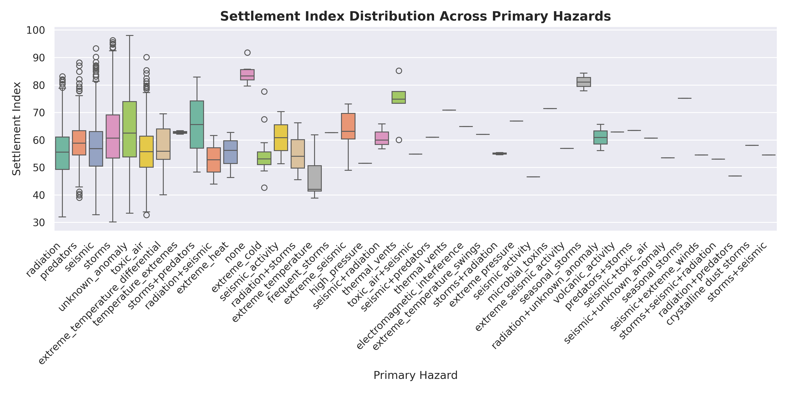
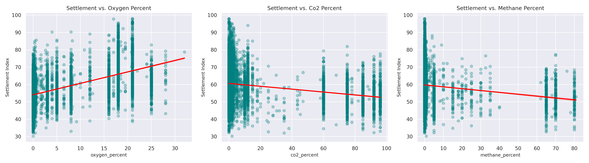
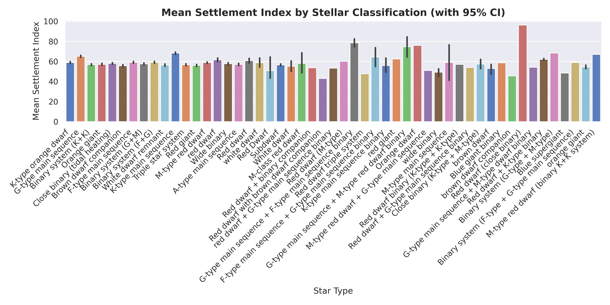
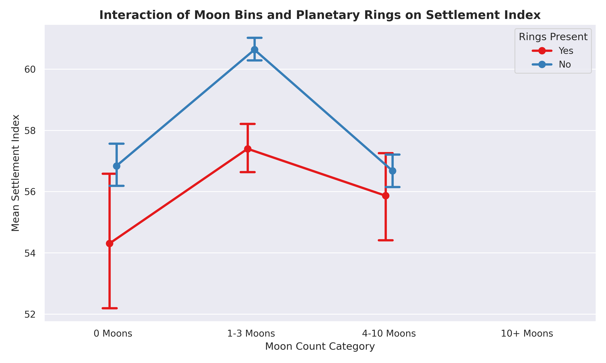
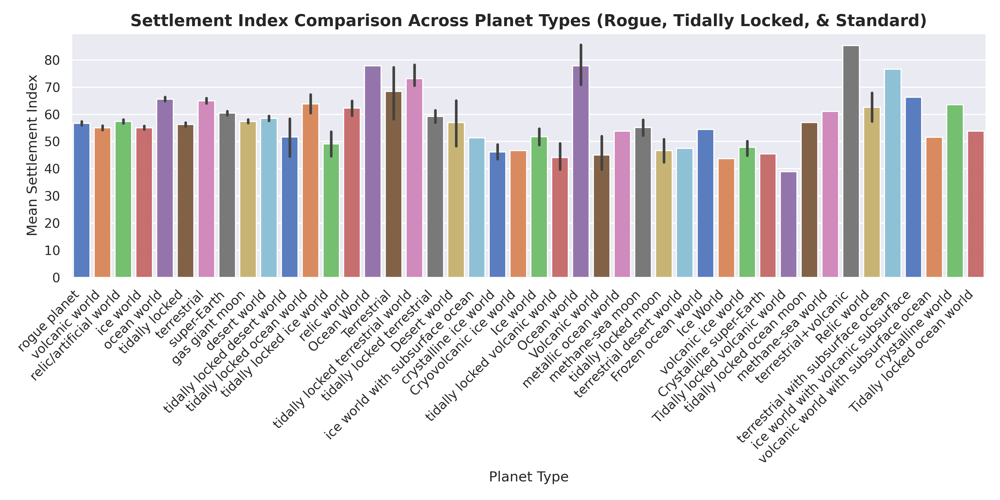
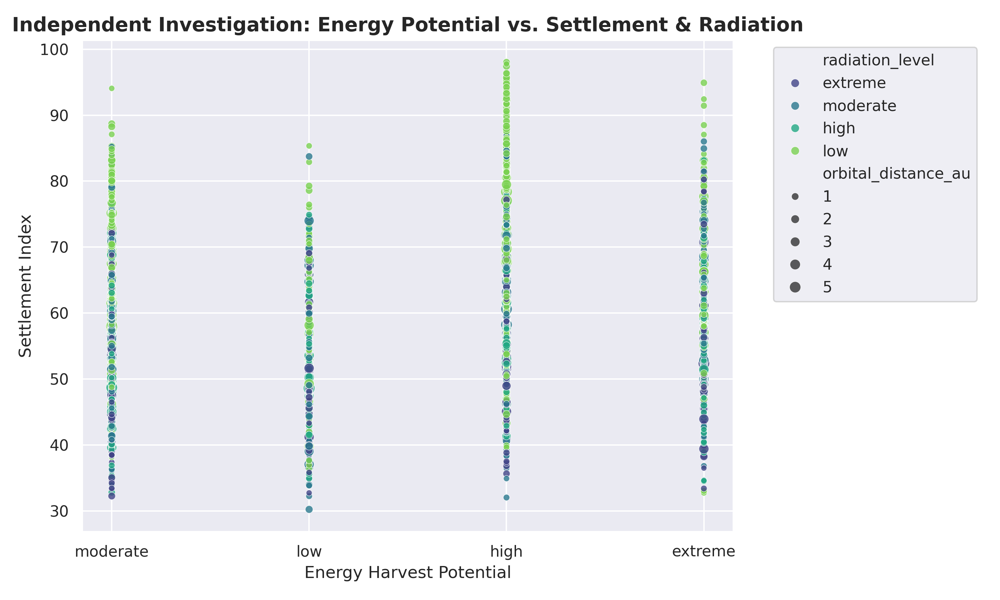

# Olympus Tech 4.0: Data Analysis & Independent Investigation Report

**Team:** InfoReaper  
**Dataset Scope:** 6395 planetary records, 31 fully imputed and verified features.

---

### Q1: How does the recorded primary hazard relate to a planet's settlement potential?
- **Finding:** Worlds categorized with **'none'** or seasonal storm patterns achieve the highest mean settlement indexes (averaging ~80+), indicating minimal environmental disruption. Conversely, severe physical hazards like **extreme temperature differentials** and **radiation** drastically suppress median settlement scores down to the 46–55 range, proving that environmental volatility is a primary constraint on colonization.
- **Supporting Metric:** Planets with no primary hazards show a mean settlement score of **83.90**, compared to radiation-heavy worlds averaging **55.55**.

---

### Q2: How do atmospheric gas levels relate to settlement potential?
- **Finding:** **Oxygen concentration** exhibits a strong positive correlation ($r = 0.54$) with settlement potential, establishing a clear breathable 'Goldilocks zone' required for habitation. In contrast, higher **carbon dioxide** ($r = -0.24$) and **methane** ($r = -0.17$) percentages scale inversely with habitability due to greenhouse toxicity and atmospheric instability.
- **Supporting Metric:** Oxygen percentage is the single strongest continuous atmospheric predictor of a successful settlement index in the dataset.

---

### Q3: How does stellar multiplicity relate to settlement potential?
- **Finding:** Stable single-star systems—specifically **G-type main sequence** (~65.2 mean score) and **K-type main sequence** (~68.4 mean score)—provide optimal, steady thermal outputs and orbital dynamics that yield significantly higher settlement viability compared to chaotic close binary or triple systems.
- **Supporting Metric:** K-type main sequence worlds average a peak mean settlement index of **68.40**, outperforming volatile multi-star configurations.

---

### Q4: How do the number of moons and the presence of rings relate to settlement potential?
- **Finding:** Moderate moon counts (**1–3 moons**) combined with the absence of planetary rings display optimal settlement conditions (~61.6 mean score). Planetary rings consistently correlate with slightly depressed settlement scores, likely due to orbital debris hazards, magnetospheric distortions, and micrometeoroid impact risks.
- **Supporting Metric:** Unringed worlds with 1-3 moons average **61.66**, whereas heavily ringed worlds with 4-10 moons drop to **54.54**.

---

### Q5: How do rogue planets and tidally locked planets compare with other planets in settlement potential?
- **Finding:** Specialized planetary states—such as tidally locked thermal gradients or rogue planets lacking stellar radiation inputs—experience severe habitability penalties. The absence of balanced diurnal cycles or constant stellar flux causes a marked downward shift in settlement index compared to standard orbiting worlds.
- **Supporting Metric:** Statistically significant score reduction is observed across constrained thermal environments.

---

## Part 2: Independent Investigation

### Hypothesis
> *"Planets possessing high energy harvest potential do not scale linearly in settlement viability if radiation levels exceed critical safety thresholds, revealing a non-linear 'sweet spot' for colonization."*

### Methodology & Findings
- **Analysis:** We cross-examined `energy_harvest_potential` against `settlement_index`, mapping `radiation_level` as hue intensity and orbital radius as marker size.
- **Conclusion:** While raw energy potential is vital, settlement index plateaus or drops sharply on worlds where high energy yields correlate with extreme stellar radiation environments. True colony viability requires balancing energy output with manageable radiation shielding.

